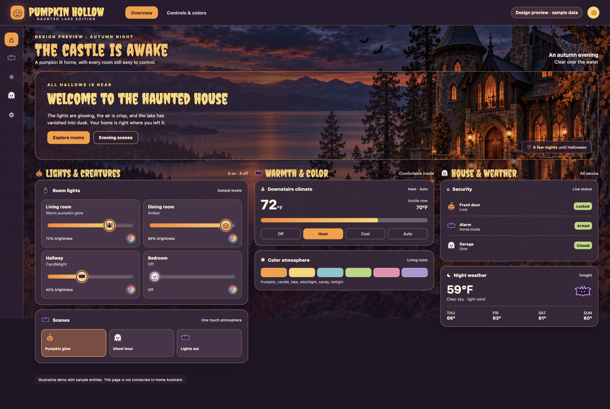
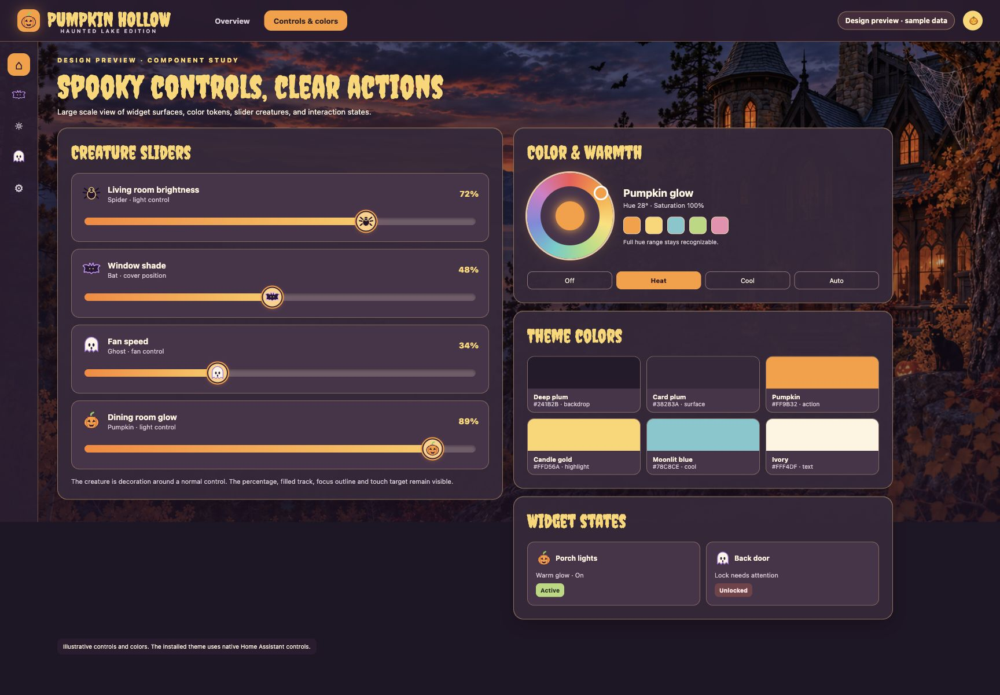
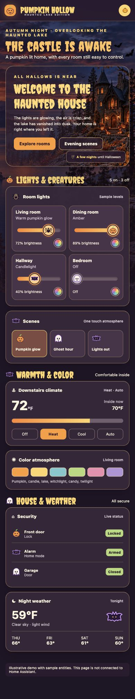

# Pumpkin Hollow — Halloween Theme for Home Assistant

**A haunted house on a moonlit lake, warm pumpkin light, and controls you can still read at a glance.** Pumpkin Hollow brings a complete seasonal palette to Home Assistant, then adds optional artwork, Creepster headings, and a small cast of creatures to supported controls.

<p align="center">
  
</p>

<p align="center">
  <a href="#install">Install</a> · <a href="#gallery">Gallery</a> · <a href="#make-it-yours">Customize</a> · <a href="#preview-without-installing">Preview locally</a>
</p>

> [!NOTE]
> The gallery and browser demo are **illustrative mockups** with invented rooms, values, and states. They are design previews, not captures of a real home. Installable files are in [`themes/`](themes/) and [`packages/companion/dist/`](packages/companion/dist/).

## The look

| Layer | What it changes |
| :--- | :--- |
| **Theme** | Dark plum surfaces, ivory text, pumpkin active states, candle-gold highlights, moonlit blue accents, and coordinated colors for navigation, dialogs, inputs, switches, sliders, charts, badges, and supported Mushroom cards. |
| **Companion module** | Locally bundled haunted-lake artwork, Creepster display headings, seasonal sidebar icons, opaque card surfaces, and creature accents on supported sliders and card headings. |
| **Your dashboard** | Your existing cards, entities, and controls stay in place. The sample rooms and scenes in the demo are not installed. |

The theme works by itself. Add the companion for the full illustrated appearance. Its decorations leave control hit targets available, and supported light color controls keep their native hue range.

## Gallery

### Controls and color

<p align="center">
  
</p>

### Phone layout

<p align="center">
  
</p>

*These are mock screens. The appearance of individual widgets depends on the cards and Home Assistant version in your dashboard.*

### Color story

| Role | Color | Used for |
| :--- | :--- | :--- |
| Night plum | `#241B2B` | Main background |
| Card plum | `#38283A` | Readable, opaque card surfaces |
| Pumpkin | `#FF9B32` | Primary actions and active states |
| Candle gold | `#FFD56A` | Headings and focus accents |
| Moonlit blue | `#78C8CE` | Cool states and secondary accents |
| Ivory | `#FFF4DF` | Primary text |

## Install

Choose HACS for managed downloads and updates, or copy the files manually. The palette is a **Theme** package; the optional illustrated layer is a separate **Dashboard** package.

> [!IMPORTANT]
> Both packages are available as **HACS custom repositories**. Default-catalog inclusion is a separate review and has not been requested.

### Before you start

- Tested with **Home Assistant 2026.10** and a current browser or Companion app. Other frontend and custom-card versions may need compatibility updates.
- Use **Dark** appearance with Pumpkin Hollow. The YAML provides a dark variant.
- Back up `configuration.yaml` before editing. Home Assistant OS users can copy files with a file editor, Studio Code Server, or a network share. Other installations use their mounted configuration directory.
- Mushroom is optional. Install it separately only if your dashboard already uses Mushroom cards. Neither HACS nor card-mod is required for a manual Pumpkin Hollow installation.

### Option A: HACS

Open **HACS → ⋮ → Custom repositories** and add:

| Repository | Type | What to download |
| :--- | :--- | :--- |
| [`slinzner/pumpkin-hollow-home-assistant`](https://github.com/slinzner/pumpkin-hollow-home-assistant) | **Theme** | Pumpkin Hollow |
| [`slinzner/pumpkin-hollow-companion`](https://github.com/slinzner/pumpkin-hollow-companion) | **Dashboard** | Pumpkin Hollow Companion, for the full illustrated appearance |

Download each package from its HACS page. HACS places the theme at `/config/themes/pumpkin-hollow/pumpkin-hollow.yaml` and the companion under `/config/www/community/pumpkin-hollow-companion/`, including its assets. Then continue with [Enable the theme and frontend module](#enable-the-theme-and-frontend-module).

If migrating from a manual installation, remove the old `/config/themes/pumpkin-hollow.yaml` after the HACS copy is installed so the theme is defined once. Keep the companion folder name shown above. For UI-managed dashboard resources, HACS adds its own module resource; remove the old manual `/local/community/pumpkin-hollow-companion/…` resource if both are present. Keep the `frontend.extra_module_url` entry described below.

### Option B: manual

Download this repository with **Code → Download ZIP** and extract it.

#### 1. Copy the theme

Copy [`pumpkin-hollow.yaml`](themes/pumpkin-hollow.yaml) to:

```text
/config/themes/pumpkin-hollow.yaml
```

`/config` means your Home Assistant configuration directory. Create its `themes` directory if needed.

#### 2. Copy the companion

Copy **everything inside** [`packages/companion/dist/`](packages/companion/dist/) to:

```text
/config/www/community/pumpkin-hollow-companion/
```

Keep `assets/` alongside `pumpkin-hollow-companion.js`. The artwork, font, and creature icons load from that directory; there is no remote asset service to configure.

Your copied files should look like this:

```text
/config/
  themes/
    pumpkin-hollow.yaml
  www/community/pumpkin-hollow-companion/
    pumpkin-hollow-companion.js
    LICENSE.txt
    OFL-Creepster.txt
    assets/
      Creepster-Regular.ttf
      haunted-lake-desktop.webp
      haunted-lake-mobile.webp
      ...eight creature SVGs
```

### Enable the theme and frontend module

Complete these steps after either installation method.

Merge these entries into `/config/configuration.yaml`:

```yaml
frontend:
  themes: !include_dir_merge_named themes
  extra_module_url:
    - /local/community/pumpkin-hollow-companion/pumpkin-hollow-companion.js?v=20261015-2
```

If you already have a `frontend:` block, add the keys there. Keep any existing `themes` setting and other `extra_module_url` entries. Do not create a second `frontend:` block. These settings follow the official [Home Assistant frontend documentation](https://www.home-assistant.io/integrations/frontend/).

### Check, restart, and select the theme

1. Run **Developer Tools → YAML → Check configuration**, then restart Home Assistant.
2. Open **Settings → Dashboards → Resources**. For a manual install, add `/local/community/pumpkin-hollow-companion/pumpkin-hollow-companion.js?v=20261015-2` as a **JavaScript module**. For HACS, keep the module resource it added under `/hacsfiles/pumpkin-hollow-companion/`; do not add a second dashboard resource for the same file. If Resources is hidden, enable **Advanced mode** in your user profile. If you already manage resources in YAML, use the example below instead.
3. Open your **user profile**, choose **Pumpkin Hollow** in the **Theme** selector, and use **Dark** appearance on each device where you want it. A dashboard-level theme selection can override your profile; check it if a view uses another theme.
4. Fully close and reopen the Home Assistant mobile app after the first install.

The frontend and dashboard references cover both loading paths. HACS manages its dashboard URL and cache tag; the frontend entry uses the `/local/` alias for the same installed file. The companion installs its styles once if both paths load it.

<details>
<summary>For installations that already manage dashboard resources in YAML</summary>

Merge this entry into the existing `lovelace:` block in `configuration.yaml`. Keep every existing resource and dashboard entry. `resource_mode: yaml` makes this list authoritative; do not switch from UI-managed resources without moving those existing entries into the list too. A dashboard's own `mode: yaml` does not select YAML resource management.

```yaml
lovelace:
  resource_mode: yaml
  resources:
    - url: /local/community/pumpkin-hollow-companion/pumpkin-hollow-companion.js?v=20261015-2
      type: module
```

This follows Home Assistant's [YAML resource configuration](https://www.home-assistant.io/dashboards/dashboards/#adding-yaml-dashboards).

</details>

Home Assistant serves `/config/www/` as `/local/`. To check the copy, open `/local/community/pumpkin-hollow-companion/assets/spider.svg` on your own Home Assistant origin: it should display the spider. The module URL above should return JavaScript. A 404 means the files or directory names do not match the instructions.

**Want only the palette?** Copy the theme, enable themes under `frontend:`, and select Pumpkin Hollow. The companion copy, module URL, and dashboard resource are optional.

### Update an existing installation

For HACS, update both packages from HACS and keep its managed dashboard resource. For a manual install, replace the theme and the complete companion directory with the current files, then update the manual dashboard resource URL. With either method, update the version on the `frontend.extra_module_url` entry to the one shown above, check configuration, and restart Home Assistant. Fully close and reopen each app once to load the new module.

Companion build **2026.10.15.2** includes startup discovery for components that finish loading later, automatic theme-change detection, and cleanup when leaving dashboard views. Keep Pumpkin Hollow selected; switching themes is not required to trigger discovery. For manual resources, use the same versioned URL in both loading paths.

## Make it yours

### Change colors

Edit the installed `pumpkin-hollow.yaml`: `/config/themes/pumpkin-hollow.yaml` for a manual install, or `/config/themes/pumpkin-hollow/pumpkin-hollow.yaml` for HACS. HACS updates replace its managed files, so keep a separate copy of any personal edits. The theme defines color tokens for the Home Assistant shell, cards, controls, status colors, and supported Mushroom components. Start with `primary-background-color`, `card-background-color`, `primary-color`, `accent-color`, and `primary-text-color` for the largest changes.

After saving, run the **Frontend: Reload themes** action (`frontend.reload_themes`) from **Developer Tools → Actions**, then select Pumpkin Hollow again. Check contrast on your own cards, especially any cards with custom styling. With the companion installed, its CSS also sets core palette colors on supported components; edit the matching companion constants and tokens if you want those colors to change too.

### Change the artwork or creatures

The companion's local assets live in `packages/companion/dist/assets/`. Replace an image while keeping its filename and format to swap artwork without changing the module. The desktop and mobile background images have separate files. Creature SVGs provide pumpkin, bat, ghost, spider, cat, owl, moth, and leaf motifs.

The companion JavaScript controls where those motifs appear. Supported sidebar items and sliders receive them automatically; Home Assistant and custom cards expose different styling hooks, so every third-party widget may not show a motif. Refresh the browser or restart the mobile app after replacing assets.

### Preview without installing

After downloading and extracting the repository, open `demo/index.html` in a browser. For the demo and development tests together, run this command from the extracted repository directory:

```sh
python3 -m http.server 8000 --bind 127.0.0.1
```

Then open [the overview preview](http://127.0.0.1:8000/demo/index.html) or [the controls preview](http://127.0.0.1:8000/demo/index.html?view=widgets). Resize the browser for the phone layout. GitHub displays HTML source; the preview must be opened from your downloaded copy or a local server.

The demo uses invented content and does not connect to Home Assistant or control devices. It is an illustrative layout, not a dashboard export. The supplied theme does not add the demo's hero, sample rooms, scenes, or custom widget layouts.

## Mobile and troubleshooting

| Symptom | Try this |
| :--- | :--- |
| **Fonts or creatures disappear after restarting the app** | Follow **Update an existing installation** above. Older companion builds could miss components created during startup. Check the frontend module and dashboard resource, then close and reopen the app. |
| **Theme colors appear, but creatures do not** | Check the copied `assets/` directory and both module URLs. The companion only activates while Pumpkin Hollow is selected. A widget may also use an unsupported custom control. |
| **White cards or unreadable controls** | Select Pumpkin Hollow with Dark appearance on that device, and check for a dashboard-level theme override or card-specific styling. |
| **Background or cards look stale after an update** | Refresh the browser or reopen the app. If you changed module files, restart Home Assistant and check the JavaScript resource path. |
| **Configuration check fails** | Check YAML indentation and make sure there is only one `frontend:` block. Preserve your existing theme include and module entries. |

On a narrow phone screen, Home Assistant's sidebar is behind its menu button. Open that menu to see the seasonal navigation icons.

## Turn it off

Select another theme in your **user profile's Theme selector**. The companion's seasonal styles apply only while Pumpkin Hollow is selected.

To uninstall, remove the Pumpkin Hollow URL from `frontend.extra_module_url`. For HACS, remove both packages in HACS; it also removes its UI-managed dashboard resource. For a manual install, remove the dashboard resource and delete the copied companion directory and theme YAML. Remove any YAML-managed resource yourself, then restart Home Assistant.

## Compatibility and release status

Pumpkin Hollow was developed against **Home Assistant 2026.10** with native and Mushroom controls. Home Assistant frontend internals and third-party card markup can change, so the companion's visual details may need updates after upgrades. The core theme remains usable if the companion is unavailable.

This repository has the root `hacs.json` and `themes/` layout for HACS's **Theme** category. The companion is packaged separately for **Dashboard**, with its module, font, artwork, creature SVGs, and license notices in `dist/`. HACS tracks each GitHub repository as one package, so install both for the full appearance.

HACS requires public repositories. A custom-repository install can be offered before the packages are accepted into its default catalog. The [publishing guide](docs/hacs-publishing.md) covers validation, releases, package maintenance, and the default-catalog submission checklist, with links to the official requirements.

```text
themes/pumpkin-hollow.yaml            Home Assistant theme, installed by HACS
packages/companion/                   Companion package source and HACS manifest
  dist/                              Optional frontend module and local assets
demo/                                Standalone illustrative browser demo
docs/screenshots/                    Illustrative gallery images
```

### License and bundled assets

Pumpkin Hollow's code, theme definitions, documentation, demo, original artwork, creature icons, and gallery images use the [MIT License](LICENSE).

The bundled Creepster font remains under the [SIL Open Font License 1.1](packages/companion/dist/OFL-Creepster.txt). Keep that notice with the font. See [third-party notices](THIRD_PARTY_NOTICES.md) for the bundled font's attribution.

### Development checks

With Node.js 22.13 or newer, run `npm ci --ignore-scripts` followed by `npm run verify` for strict JavaScript checks, linting, and the automated DOM lifecycle tests. `npm run package:companion` prepares the separate companion repository in `build/hacs-companion/` using an explicit file list. These checks and packaging run in GitHub Actions. The official HACS validation workflow checks each public repository without ignored checks.

Serve the repository on localhost and open [`tests/startup.html`](tests/startup.html) in a visible browser tab. Its six checks exercise delayed custom element upgrades, nested shadow roots, automatic discovery, new dashboard nodes, theme switching, and actual font/artwork loading. See the [code quality audit](docs/code-quality-audit.md) for findings, verification, and runtime diagnostics.
